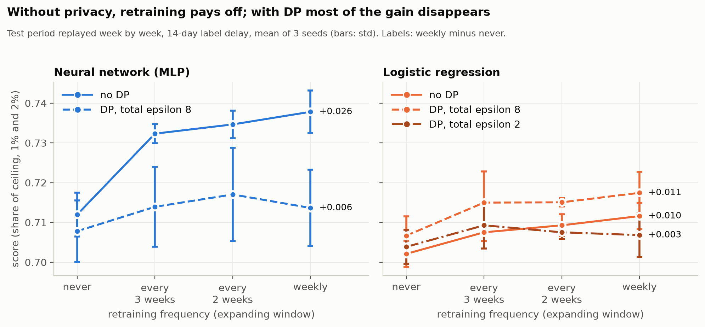
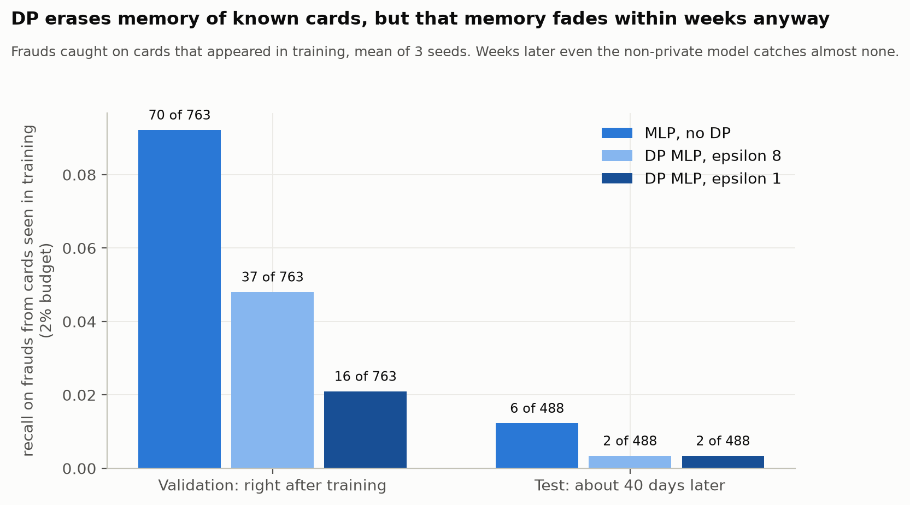
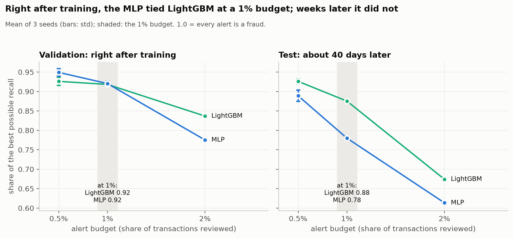
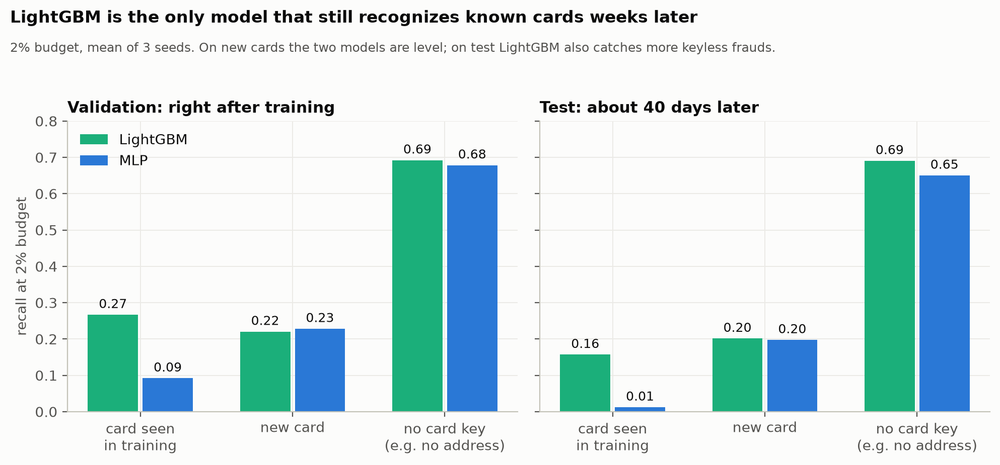
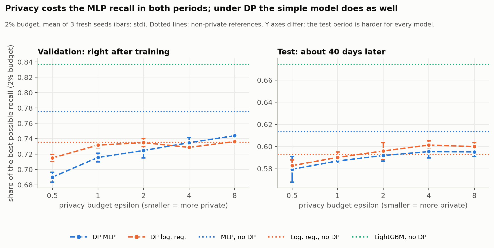
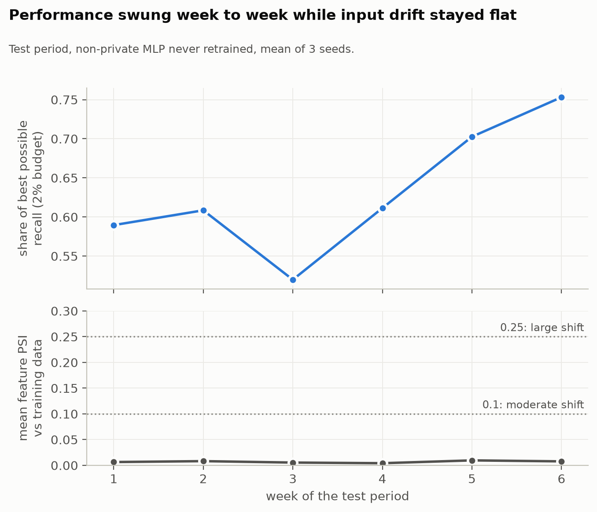

# Private Fraud Models Under Realistic Operations

**What does privacy cost a fraud model, and how does that cost change when fraud drifts and fraudsters adapt?**

This project is an applied empirical study of fraud detection with differential privacy (DP). It measures how much fraud a model catches at a fixed review capacity (the alert budget) as privacy tightens, then tests those private models under time-ordered replay, drift, an adaptive adversary, and a compact federated setting where institutions cannot pool raw data.

> Status: core project complete (stages 1 to 3, including the one-time test-set evaluation), with the full write-up in [`docs/writeup.md`](docs/writeup.md). Stages 4 and 5 are stretch goals.

---

## Research questions

1. **Privacy cost.** At a fixed alert budget, how much fraud recall does a model lose as the DP budget (epsilon) tightens?
2. **Operations.** How do private models degrade over time under drift, and what is the best retraining cadence when every retrain spends privacy budget? Under DP, retraining on data the model has already seen is not free: the privacy loss of every retrain that touches a transaction adds up. Retraining more often fights drift but exhausts a fixed total budget faster, leaving more noise in each model.
3. **Adversaries.** When fraudsters adapt to a deployed model, do private models break faster, and what does it cost in dollars?
4. **Collaboration.** When banks cannot share data, does federated training help the smallest institution?

## Why the framing matters

Most fraud projects report accuracy or ROC-AUC on a random split. Real fraud teams work differently:

- **Alert budget:** analysts can only review a small fraction of transactions, so the metric that matters is recall within that budget.
- **Time:** fraud patterns drift, so models are trained on the past and evaluated on the future.
- **Money:** missing a $5,000 fraud is worse than missing a $5 one, so losses are dollar-weighted.
- **Privacy:** regulation limits how transaction data can be used and shared.

This project evaluates every model under those conditions.

## Setup

- **Data:** [IEEE-CIS Fraud Detection](https://www.kaggle.com/c/ieee-fraud-detection) (Kaggle). About 590k transactions, about 3.5% fraud, with heavy missingness and anonymized features.
- **Split:** time-based. Train on the earliest period, validate on the middle, test on the latest. No shuffling.
- **Alert budget:** the fraction of all transactions in the evaluation period that the model flags for review (the top k% by score). This is not the same as a false-positive rate.
- **Primary metrics:** recall at 1% and 2% alert budgets (co-primary). Sensitivity check at 0.5%. Both budgets are reported because the top 1% fills with easy frauds: in stage 1, LightGBM and the MLP tie at 1% (share of ceiling 0.921) but differ clearly at 2% (0.842 vs 0.775). A single 1% budget could hide the cost of privacy.
- **Recall ceiling:** a budget smaller than the fraud rate caps achievable recall (at 1% with about 3.5% fraud, even a perfect model catches at most about 29%). Every recall figure is reported alongside its ceiling and as a share of that ceiling.
- **Secondary metrics:** precision at the budget, PR-AUC, dollar loss (total amount of fraud not flagged within the budget), calibration error.
- **Seen vs new cards:** recall is also broken down by whether a transaction's card (approximated from `card1`, `addr1`, and `D1`) appears in training. Labels in IEEE-CIS cluster by card, so this shows how much performance comes from familiar cards. The card identifier is used for evaluation only, never as a model input.
- **Privacy unit:** transaction-level DP via DP-SGD. All epsilon values use delta = 1e-6, below 1/n for the training set.
- **Cumulative privacy:** when a transaction is used by more than one training run (retraining in stage 3, rounds in stage 5), the reported epsilon is the cumulative value composed across all of those runs, not the per-run value.
- **Seeds:** at least 3 per configuration. Results report mean and spread.

## Stages

| # | Stage | What it answers |
|---|---|---|
| 1 | Baselines | LightGBM with calibration, plus a non-private MLP with the same architecture as the DP model. The non-private references. |
| 2 | DP sweep | DP-SGD MLP (Opacus) and DP logistic regression across epsilon of 0.5, 1, 2, 4, 8, and no DP. |
| 3 | Replay and drift | Score the test period in time order and monitor drift. Compare retraining cadences under a fixed total privacy budget: each retrain's privacy loss composes with every earlier run on the same transactions, so cadence trades recovery from drift against noise per model. |
| 4 | Adaptive adversary (stretch) | Fraudsters shift behavior after deployment. Measure decay and recovery for private vs non-private models. |
| 5 | Federated (stretch) | 3 simulated banks with different fraud rates, formed by a fixed partition rule recorded in `docs/decisions.md`. Local-only vs federated (Flower) vs pooled, at 2 to 3 epsilon values. |
| 6 | Write-up | Report, figures, and conclusions. |

## Results

**The short version.** What differential privacy takes away from a fraud model is mostly its memory of recent, specific patterns, such as cards it has already seen. Right after training that memory is valuable, and DP removes it. Weeks later it has largely gone stale, so a model trained once pays little for privacy by then. Retraining is what keeps the memory fresh, and that is where privacy costs the most: without privacy, weekly retraining improves the neural network by +0.026; with DP the gain is about +0.006, and the gap between private and non-private models grows six-fold. **Privacy's real cost is losing the ability to keep a model fresh, not the drop you measure on day one.**

All numbers: mean of 3 seeds never used for tuning. Recall is shown with its share of the ceiling in parentheses. DP rows report the target epsilon; the epsilon actually spent never exceeded it (delta = 1e-6, RDP accountant). Full record, including every decision and caveat: `docs/decisions.md`.





### Stages 1 and 2: one-time test-set evaluation

Test period: 42 days starting about 40 days after the end of training; 118,108 transactions, 4,064 frauds; ceilings 0.291 at 1% and 0.581 at 2%. Models are trained on the training period only.

| Model | Epsilon | Recall @ 1% (share of ceiling) | Recall @ 2% (share of ceiling) | PR-AUC | Dollar loss @ 2% |
|---|---|---|---|---|---|
| LightGBM | none | 0.255 (0.875) | 0.392 (0.674) | 0.508 | $441k |
| MLP | none | 0.227 (0.780) | 0.357 (0.613) | 0.445 | $463k |
| MLP + DP-SGD | 8 | 0.236 (0.812) | 0.346 (0.595) | 0.425 | $479k |
| MLP + DP-SGD | 4 | 0.236 (0.813) | 0.346 (0.595) | 0.424 | $482k |
| MLP + DP-SGD | 2 | 0.239 (0.820) | 0.344 (0.592) | 0.421 | $481k |
| MLP + DP-SGD | 1 | 0.237 (0.813) | 0.341 (0.587) | 0.412 | $489k |
| MLP + DP-SGD | 0.5 | 0.236 (0.810) | 0.337 (0.579) | 0.401 | $491k |
| Logistic regression | none | 0.233 (0.801) | 0.345 (0.593) | 0.433 | $475k |
| Logistic regression + DP-SGD | 8 | 0.238 (0.818) | 0.349 (0.600) | 0.438 | $479k |
| Logistic regression + DP-SGD | 4 | 0.238 (0.817) | 0.350 (0.601) | 0.430 | $482k |
| Logistic regression + DP-SGD | 2 | 0.237 (0.814) | 0.347 (0.596) | 0.433 | $479k |
| Logistic regression + DP-SGD | 1 | 0.236 (0.811) | 0.343 (0.590) | 0.428 | $479k |
| Logistic regression + DP-SGD | 0.5 | 0.233 (0.803) | 0.339 (0.583) | 0.418 | $481k |

For comparison, the validation period (the 40 days right after training, used for tuning; ceilings 0.256 and 0.512):

<details>
<summary>Validation results</summary>

| Model | Epsilon | Recall @ 1% (share of ceiling) | Recall @ 2% (share of ceiling) | PR-AUC | Dollar loss @ 2% |
|---|---|---|---|---|---|
| LightGBM | none | 0.235 (0.918) | 0.429 (0.837) | 0.625 | $543k |
| MLP | none | 0.236 (0.920) | 0.397 (0.775) | 0.562 | $581k |
| MLP + DP-SGD | 8 | 0.234 (0.915) | 0.381 (0.744) | 0.519 | $622k |
| MLP + DP-SGD | 4 | 0.233 (0.910) | 0.377 (0.735) | 0.512 | $629k |
| MLP + DP-SGD | 2 | 0.233 (0.907) | 0.371 (0.725) | 0.504 | $634k |
| MLP + DP-SGD | 1 | 0.230 (0.899) | 0.367 (0.716) | 0.490 | $646k |
| MLP + DP-SGD | 0.5 | 0.228 (0.889) | 0.354 (0.690) | 0.472 | $653k |
| Logistic regression | none | 0.234 (0.914) | 0.377 (0.735) | 0.521 | $618k |
| Logistic regression + DP-SGD | 8 | 0.232 (0.906) | 0.377 (0.736) | 0.520 | $618k |
| Logistic regression + DP-SGD | 4 | 0.231 (0.901) | 0.373 (0.729) | 0.503 | $628k |
| Logistic regression + DP-SGD | 2 | 0.231 (0.902) | 0.377 (0.735) | 0.516 | $618k |
| Logistic regression + DP-SGD | 1 | 0.231 (0.900) | 0.375 (0.732) | 0.511 | $621k |
| Logistic regression + DP-SGD | 0.5 | 0.229 (0.893) | 0.366 (0.715) | 0.500 | $629k |

</details>

**What held on the later test period:**

- **LightGBM is the strongest model by a clear margin** (selection score 0.775 vs about 0.70 for all others).
- **Privacy costs the MLP recall** at the 2% budget and in PR-AUC, more as epsilon shrinks (PR-AUC 0.445 without DP, 0.425 at epsilon 8, 0.401 at epsilon 0.5).
- **Under DP the simple model does as well as the neural network** at every epsilon.
- **Calibration holds out of sample** (expected calibration error 0.004 to 0.006 for every model).

**What changed between the two periods:**

- **Card memory fades.** Right after training, the non-private MLP catches 70 of 763 frauds on cards seen in training, and DP at epsilon 1 removes 77% of those catches. About 40 days later it catches only 6 of 488, so there is little left for privacy to remove. LightGBM is the only model that still recognizes known cards weeks later (recall 0.16 vs 0.01).
- **The 1% budget hid a difference that later appeared.** Right after training, the MLP tied LightGBM at a 1% budget (0.92 vs 0.92); later it did not (0.78 vs 0.88).
- **The MLP's edge over logistic regression is gone later on,** with or without privacy (0.697 vs 0.697).
- **Caveat:** on the test period some DP models score above their non-private versions. The DP MLP is above the non-private MLP at the 1% budget (0.81 to 0.82 vs 0.78) but below it at 2% and in PR-AUC. DP logistic regression at epsilon 2 to 8 is slightly above non-private logistic regression on all three (for example PR-AUC 0.438 vs 0.433 at epsilon 8). Post-hoc checks in stage 3 traced a similar effect to DP's gradient clipping, which limits the influence of outlier transactions under drift; it is not a benefit of privacy.







### Stage 3: retraining under a fixed privacy budget (test period, run once)

The test period (42 days) is replayed week by week. Each week is scored by the latest model; models are retrained never, or every 3, 2, or 1 weeks, using only labels at least 14 days old. Two strategies: **expanding** (retrain from scratch on all labeled data; every retrain reuses earlier transactions, so the total budget is split across retrains by RDP composition) and **disjoint** (fine-tune the previous model on new data only; each retrain gets the full budget). Score = average share of ceiling at 1% and 2% of each week's transactions, pooled over weeks; mean of 3 seeds (spread about 0.005). Every DP total stayed within its budget.

| Schedule | Logistic regression | DP LR, total eps 8 | DP LR, total eps 2 | MLP | DP MLP, total eps 8 |
|---|---|---|---|---|---|
| Never retrain | 0.702 | 0.707 | 0.704 | 0.712 | 0.708 |
| Expanding, every 3 weeks | 0.708 | 0.715 | 0.709 | 0.732 | 0.714 |
| Expanding, every 2 weeks | 0.709 | 0.715 | 0.708 | 0.735 | 0.717 |
| Expanding, weekly | 0.712 | 0.717 | 0.707 | 0.738 | 0.714 |
| Disjoint, every 3 weeks | 0.694 | 0.710 | 0.701 | 0.720 | 0.710 |
| Disjoint, every 2 weeks | 0.691 | 0.713 | 0.705 | 0.725 | 0.709 |
| Disjoint, weekly | 0.685 | 0.712 | 0.702 | 0.724 | 0.708 |

- **Privacy takes away most of the benefit of retraining the neural network.** Without privacy, weekly retraining improves the MLP by +0.026; with DP at total epsilon 8 the best schedule gains +0.009.
- **Static evaluation understates the cost of privacy.** Never retrained, the DP MLP is 0.004 below the non-private MLP; with weekly retraining the gap is 0.024.
- **The simple model keeps its retraining benefit at a loose budget** (+0.011 at total epsilon 8, as without privacy) but loses half of it at total epsilon 2.
- **Retrain on all data, not only new data.** Expanding beats disjoint for every model; a full budget per retrain does not make up for training on one or two weeks of data.
- **Input drift monitoring did not track performance.** Mean feature PSI per week stayed at 0.004 to 0.010 while weekly share of ceiling ranged from about 0.50 to 0.75.
- **Caveat:** DP logistic regression scores slightly above non-private logistic regression on test. Post-hoc checks show this comes from gradient clipping (clipping alone adds +0.017; the privacy noise then costs about 0.008), not from privacy. It does not appear on validation. See `docs/decisions.md`.



## Repository layout

```
fraud-privacy-lab/
  configs/            experiment configs (one YAML per run family)
  data/               raw and processed data (gitignored)
  docs/               scope, decisions log, write-up drafts
  notebooks/          EDA and results figures only
  results/            generated tables, figures, run logs
  scripts/            entry points (download data, run sweeps)
  src/fraudpriv/
    data.py           loading, cleaning, time split
    features.py       shared preprocessing used by every model
    metrics.py        recall at alert budget, dollar loss, PR-AUC
    run.py            config-driven experiment runner
    baseline.py       LightGBM + calibration, non-private MLP
    dp_train.py       DP-SGD (Opacus) and DP logistic regression
    replay.py         time-ordered scoring of the test period
    drift.py          drift monitoring and retraining schedules under a total privacy budget
    adversary.py      adaptive adversary simulation (stretch)
    federated.py      Flower simulation (stretch)
    serve/api.py      FastAPI scoring endpoint (stretch)
  tests/              unit tests (metrics first)
```

## Quickstart

Commands for later stages become available as those stages are completed.

```bash
# 1. Environment (Python 3.11)
python -m venv .venv
source .venv/bin/activate        # macOS / Linux
# .\.venv\Scripts\Activate.ps1   # Windows PowerShell
pip install -r requirements.txt
pip install -e .

# 2. Data: checks data/raw/ieee-cis/ and prints manual download steps if files are missing
python scripts/download_data.py

# 3. Freeze the time split
python -m fraudpriv.data --build-split

# 4. Run the baselines (validation only; add --final with eval_split: test for the test set)
python -m fraudpriv.run --config configs/baseline_lgbm.yaml
python -m fraudpriv.run --config configs/baseline_mlp.yaml

# 5. DP sweep, step 1 (validation only; configs use device: cuda, see requirements.txt)
python -m fraudpriv.run --config configs/dp_mlp.yaml
python -m fraudpriv.run --config configs/dp_mlp.yaml --only target_epsilon=1   # one epsilon

# 6. Replay and retraining (stage 3): development replay on validation, then the final one
python -m fraudpriv.replay --config configs/replay_dev.yaml
python -m fraudpriv.replay --config configs/replay_final.yaml --final

# 7. Tests
pytest
```

## Related work

DP and federated learning for fraud detection are active research areas, and this project does not claim a new method. Its contribution is a careful operational evaluation: alert-budget and dollar metrics, time-based splits, multiple seeds, and stress tests under drift and adaptive adversaries. Its most specific question is how retraining cadence should be chosen when retrains compose against a fixed privacy budget. The related-work section and the full report are in [`docs/writeup.md`](docs/writeup.md).

## Limitations

- IEEE-CIS features are anonymized, which limits domain-driven feature engineering.
- The data is a static snapshot, so drift and adversary experiments are simulations built on replay.
- Federated results use simulated institutions, not real banks.
- DP is at the transaction level. A card or customer with many transactions is protected more weakly than a single transaction; card-level DP is out of scope.
- The privacy guarantee covers model training only. Preprocessing statistics (encodings, imputation values) are computed without DP, and hyperparameter tuning is not charged to the privacy budget.
- Platt calibration is fit on validation labels without DP. It is strictly increasing, so recall, precision, and dollar loss do not depend on it; only calibration error does.

## Author

Dang Dinh, MS Data Science, Boston University. [GitHub](https://github.com/dangdinh99) · [Portfolio](https://dangdinh99.github.io/Portfolio/)
